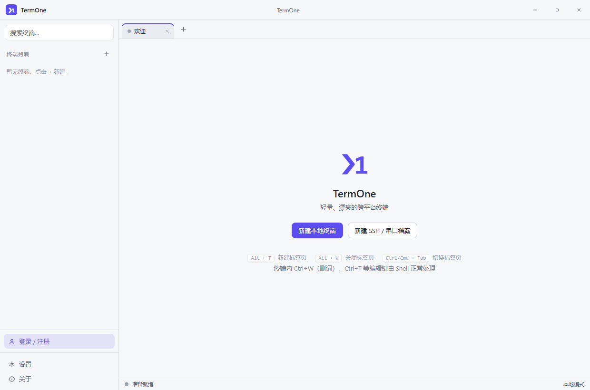
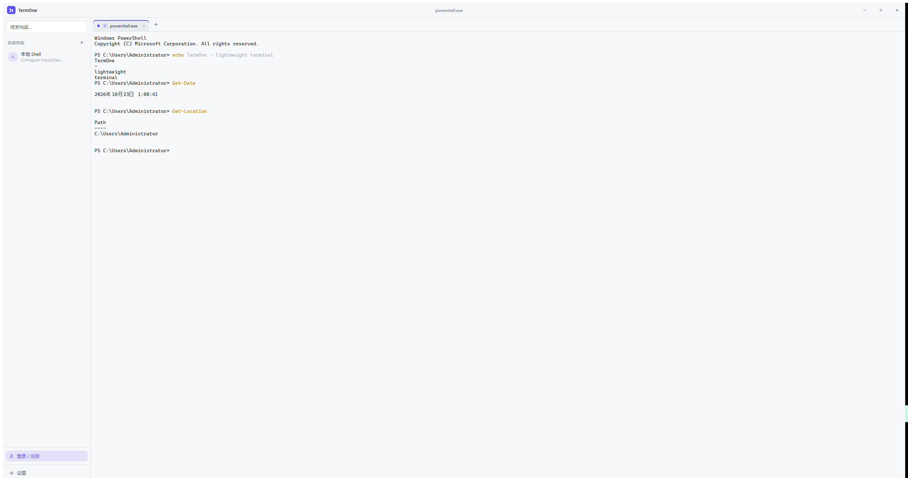
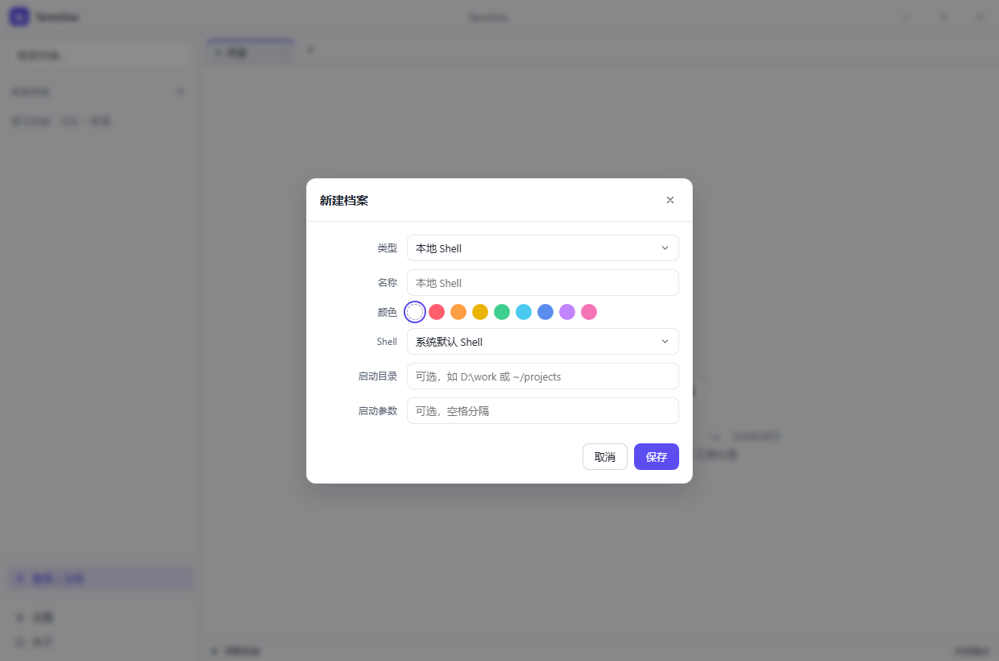
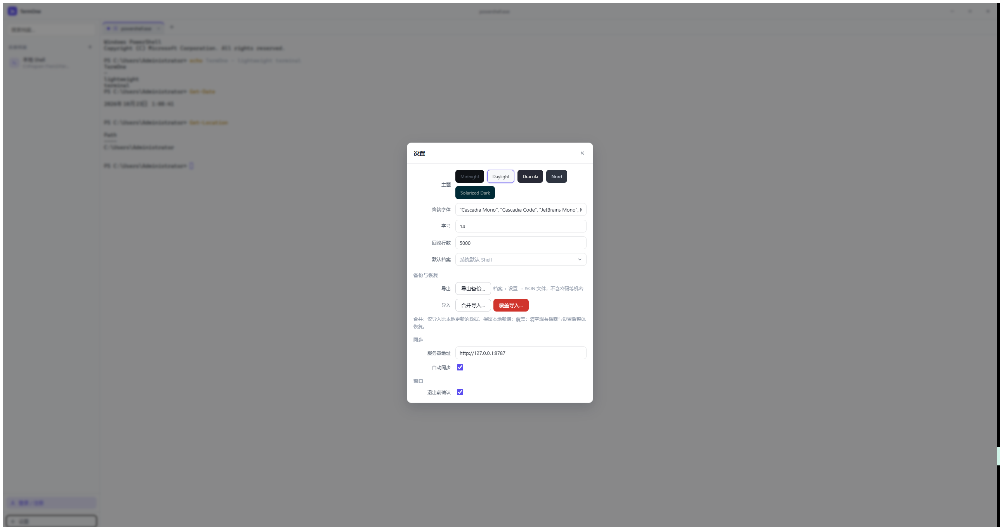

# TermOne

轻量、漂亮的跨平台终端软件（Windows / macOS / Linux），参考 Tabby、WindTerm 设计。

> GitHub：https://github.com/aa24615/TermOne

- **本地终端**：PowerShell / pwsh / zsh / bash，多标签页
- **SSH 远程**：基于系统 OpenSSH，密钥 / Agent / 密码认证，known_hosts 与系统一致
- **串口 Serial**：USB-TTL 调试（波特率 / 数据位 / 校验 / 流控可配）
- **本地 SQLite**：连接档案与设置存于本地数据库，无网络也可用
- **本地备份**：一键导出/导入 JSON（档案 + 设置；合并/覆盖两种模式；不含机密）
- **云同步**：自建同步服务（REST + JWT），档案与设置多设备同步备份
- **安全设计**：SSH 密码、密钥口令等机密保存在 OS 密钥环（Windows Credential Manager / macOS Keychain），**永不上传**
- **主题**：Midnight / Daylight / Dracula / Nord / Solarized Dark

## 界面预览

| 欢迎 | 本地终端 |
| --- | --- |
|  |  |
| **新建档案** | **设置** |
|  |  |

## 技术栈

| 层 | 技术 |
| --- | --- |
| 桌面壳 | Tauri 2（Rust） |
| 终端核心 | `crates/term-core`：portable-pty（本地/SSH）、serialport（串口）、rusqlite（存储）、keyring（机密） |
| 前端 | React 18 + TypeScript + Zustand + xterm.js |
| 服务端 | Node.js + Fastify + JWT + node:sqlite（零原生依赖） |
| 同步协议 | 增量 pull / push，按 `updatedAt` 最后写入胜出（LWW），支持删除传播 |

## 目录结构

```
├── apps/desktop          # 桌面应用（Tauri + React）
│   ├── src               #   前端源码
│   └── src-tauri         #   Rust 壳（commands / 事件 / 窗口）
├── apps/server           # 同步服务端（Fastify + JWT + SQLite）
├── crates/term-core      # 核心库：会话 / 存储 / 密钥环（可独立测试）
├── docs/需求.md           # 需求记录
└── tools/gen_icons.py    # 图标生成脚本（纯标准库）
```

## 快速开始（桌面端）

依赖：Node.js ≥ 23.4（服务端使用内置 `node:sqlite`）、Rust 1.99.1（本期验证版本）；Windows 需 MSVC 工具链与 WebView2，macOS 需 Xcode Command Line Tools；Linux 依赖见 `tools/linux/dependencies.sh`。

```bash
# 1) 安装依赖（npm workspaces）
npm install

# 2) 开发模式运行桌面端（首次会编译 Rust，需要较长时间）
cd apps/desktop
npm run tauri dev

# 3) 构建发布包（Windows 生成 msi/nsis，macOS 生成 app/dmg）
npm run tauri build
```

## 从其他软件导入 SSH 连接

主窗口左下角点击 **导入 SSH 配置**，选择文件（可多选）或原软件的会话目录，也可以粘贴配置。核对预览、选择目标分组和连接，再确认导入。默认按主机、端口、用户名、跳板机跳过重复连接，保留现有档案；原分组在目标分组下合并创建，新增连接参与原有同步。

- **Tabby**：`config.yaml`，读取 SSH profiles、组名/父组、全局和所在组的 SSH 默认值、私钥路径、跳板机引用链；本地 Shell 和模板不导入。
- **WindTerm**：`profiles/default.v10/terminal/user.sessions`（版本目录可能不同），读取 SSH 会话、分组、`user@host` 和私钥路径。
- **electerm**：设置 → 同步 → 导出的全量 JSON，或复制的单个书签 JSON / 书签数组；保留嵌套分组、用户名、端口、私钥路径和跳板链，解析导出文件中的认证档案引用。内嵌私钥、密码与证书不迁移。
- **iTerm2**：设置 → Profiles → Other Actions → Save Profile as JSON，或选择 `com.googlecode.iterm2.plist`（支持二进制/XML）；读取直接 `ssh` 命令、SSH 启动文本和同文件父 Profile，支持端口/用户/私钥/跳板/转发选项，首个标签作为分组。shell 包装、复合命令、动态表达式、`ProxyCommand` 和外部 `-F` 配置会跳过并提示；不会执行 Profile 中的命令。
- **Termius**：接受准备好的 **CSV / OpenSSH** 迁移文件。不直接解析当前 Termius 的加密数据目录；官方旧版 CLI 曾提供 `export-ssh-config`，但[仓库已归档](https://github.com/termius/termius-cli)，不保证适用于当前版本。
- 其他适配：OpenSSH `config`、Xshell `.xsh` / 未加密 `.xts`、FinalShell `conn` JSON、SecureCRT Sessions INI / XML、PuTTY / KiTTY Sessions `.reg`、MobaXterm INI / 文本会话导出、mRemoteNG / SuperPuTTY XML、WinSCP INI、Remmina、通用 CSV。ZIP / XTS 只读取支持的文本配置，不在磁盘解压。

通用 CSV 示例（也接受 `address` / `ssh_port` / `ssh_username` / `groups` 等常见字段和中文表头）：

```csv
name,host,port,username,group
生产服务器,192.0.2.10,22,root,生产/华东
```

密码不迁移，首次连接时重新输入；私钥只记录路径，跨电脑迁移后请重新选择本机私钥，PPK 需转换为 OpenSSH 格式。未迁移的代理、隧道、登录脚本会在预览中提示。OpenSSH 不执行 `Match exec` / `ProxyCommand`、不自动读取 `Include`；依赖 ProxyCommand 的主机跳过并提示。加密归档须先在原软件导出明文配置。支持 UTF-8、带 BOM 的 UTF-16 和 GB18030；一次最多 1000 文件 / 10000 连接，单文件 16 MiB、合计 32 MiB。连接与分组在同一数据库事务内保存，失败整批回滚。

PuTTY 使用 Sessions 注册表 `.reg` 导出，Xshell 使用 `.xsh` / 未加密 `.xts`，MobaXterm 使用 INI / 文本会话导出；WinSCP 使用 INI，只迁移 SCP/SFTP/SFTP-only（官方协议编号 0/1/2），排除 FTP/WebDAV/S3。WinSCP、MobaXterm 的大小写不同会话名分别保留。

## 服务端 Docker 部署

```bash
# 本地构建并启动（推荐，数据持久化在 named volume /data）
# 注意：构建上下文必须是仓库根目录，多阶段 Dockerfile 会在镜像内
# 先构建 apps/web，再由服务端托管 /web/dist（同源 Web SSH 控制台）。
docker compose up -d --build

# 或手动构建运行
docker build -t termone-server -f apps/server/Dockerfile .
docker run -d -p 8787:8787 -v termone-data:/data termone-server

# 使用 CI 推送到制品库的镜像（替换仓库路径）
docker run -d -p 8787:8787 -v termone-data:/data \
  docker.cnb.cool/zyan2026/sshz/termone-server:latest
```

- 镜像同时包含**服务端 API 与构建好的 Web SSH 控制台**，二者同源同端口 `8787`，无需单独部署前端。
- 数据目录：容器内 `/data`（`TERMONE_DATA` 可改），含 `termone-server.db`、`jwt.secret`、`cred.key`（凭据主密钥）；均以 `0600` 生成，挂载 named volume 可跨容器重启保留。
- 生产环境建议置于反向代理 + HTTPS 之后。

## 发版与打包

### GitHub Actions（macOS 自动打包与发布）

进入 GitHub 仓库 **Actions → macOS Release → Run workflow**，选择 `main`。版本号留空会在源码与已预留标签的最高版本上递增补丁号；也可指定更高的 `X.Y.Z`。流水线先提交统一的版本文件并原子推送版本标签，再从这个固定提交分别在 Apple Silicon / Intel runner 上执行测试、构建和校验。两个架构都成功后，才公开 GitHub Release。

Release 包含两种架构的 DMG、应用 ZIP 和 `SHA256SUMS.txt`。DMG 直接生成，不依赖 Finder 自动排版；应用做 ad-hoc 签名，未配置 Apple Developer 签名或公证。仅使用仓库自带 `GITHUB_TOKEN`，无需个人访问令牌或自托管 macOS 节点。构建任务只有读取权限，预留版本和发布任务拥有写入 Release 所需的 `contents: write` 权限。

发版整体串行；失败版本保留，重新发起工作流会继续递增，防止重复占用同一版本。也可以在 GitHub 界面对同一次运行选择“重新运行失败的作业”，继续该次已经预留的版本。源码与标签不会被强制覆盖。

GitHub Actions 仅向 GitHub 写入发版提交及标签；本机仍保留 GitHub + CNB 双推配置。CI 发版完成后，本机可执行下面的命令同步版本，再继续本地开发/打包：

```bash
git fetch github main --tags
git merge --ff-only github/main
git push origin main
```

工作流：`.github/workflows/macos-release.yml`；版本预留、macOS 制品生成和 Release 发布分别由 `scripts/github-release-version.mjs`、`scripts/package-macos.mjs`、`scripts/publish-github-release.sh` 实现。

### 本地版本规则与 CNB 流水线

本地打包统一使用 `npm run tauri -- build`，或 `npm run tauri --workspace @termone/desktop -- build --bundles app,dmg`。每次打包前自动递增补丁版本（如 `0.1.0 → 0.1.1 → 0.1.2`），同步 Tauri、桌面 npm 包、Cargo workspace 与锁文件；安装包文件名、关于页面和状态栏使用同一版本。开发预览、前端构建、类型检查与 `build --help` 不递增。

版本在编译前写入源码，打包失败也不回退，下次重试继续递增。打包完成后将版本文件一并提交，确保下次构建从最新版本继续。不要直接运行 `npx tauri build` 绕过项目入口；`tauri bundle` 会提示改用 `build`，避免旧二进制被重新包装。

CI 通过 `TERMONE_RELEASE_VERSION` 使用按钮指定的发布版本（可带 `v` 前缀，不能低于源码版本），同一次 Release 的 Windows、macOS、Linux 产物保持相同版本；此指定方式覆盖自动补丁递增。服务端、Web 和扩展包各自的版本独立管理。

**客户端发版由按钮触发**：打开仓库 `main` 分支详情页 → 点击「发版 Release（客户端）」按钮 →
输入版本号（如 `0.1.0`）确认即可。流水线会自动：

1. 创建并推送 `v0.1.0` 标签
2. Windows / macOS 自托管节点与 Linux 云端节点打包并上传 Release 附件（Release 自动创建）

服务端镜像独立发布：点击「发布服务端镜像」按钮输入版本号，与客户端发版互不影响。

| 按钮 / 流水线 | 运行节点 | 产物 |
| --- | --- | --- |
| 发版 Release（客户端）→ `create-tag` | 云端 Linux | `v*` 标签 |
| 发版 Release（客户端）→ `desktop-windows` | 自托管 Windows（tags: `windows, x64`） | NSIS `.exe` / `.msi` → Release 附件 |
| 发版 Release（客户端）→ `desktop-macos` | 自托管 macOS（tags: `macos, arm64`） | `.dmg` → Release 附件 |
| 发布服务端镜像 → `server-image` | 云端 Linux | Docker 镜像 `v*` + `latest` |
| 发版 Release（客户端）→ `desktop-linux` | 云端 Linux | DEB / RPM / AppImage → Release 附件 |
| `check` / main push | 云端 Linux | 三端类型检查 + 前端构建 + 桌面测试 |

桌面端两条流水线依赖根组织自托管构建机（云端节点仅 Linux，无法打包 Win/Mac）：
按 [构建节点文档](https://docs.cnb.cool/zh/build/build-node.md) 接入后，节点需预装
Node.js ≥ 20 与 Rust 工具链（Windows 含 MSVC、macOS 含 Xcode CLT）。安装包通过
OpenAPI 三步协议（申请预签名 URL → PUT → 确认）直传 Release，脚本见
`scripts/upload-release-assets.mjs`。

## 检查与测试

```bash
npm run check                         # 前端 + 服务端 TypeScript 类型检查
cargo test -p term-core               # 核心库单元测试（存储 / LWW 合并）
```

## Web 版 SSH 远程管理（apps/web）

浏览器端的 SSH 远程管理控制台，**仅做远程 SSH**（不做本地终端 / 串口）。服务端作为 SSH 网关，
浏览器通过 WebSocket 与之通信，服务端用 `ssh2` 连接目标主机并双向透传。

```bash
npm run dev:server     # 服务端：http://127.0.0.1:8787
npm run dev:web        # Web 客户端：http://127.0.0.1:5273（已代理 /api 与 WebSocket）
```

生产模式无需单独部署前端：服务端会自动托管 `apps/web/dist`（同源，无跨域）。

```bash
npm run build --workspace @termone/web
npm run start --workspace @termone/server   # 直接访问 http://<host>:8787
```

### 接口

| 方法 | 路径 | 说明 |
| --- | --- | --- |
| GET | `/api/ssh/hosts` | 主机列表（**仅元数据 + `hasCredential`**，不含凭据；与桌面端同步的档案同源） |
| POST | `/api/ssh/hosts` | 新增主机（**不带凭据即为「不上传」**；带凭据则加密落盘） |
| PATCH | `/api/ssh/hosts/:id` | 编辑（凭据留空 = 保持不变；`clearCredential:true` = 删除服务端凭据） |
| DELETE | `/api/ssh/hosts/:id` | 删除主机（打 tombstone，随同步传播到桌面端） |
| WS | `/api/ws/ssh?token=<jwt>` | SSH 会话网关（connect 帧可带临时凭据，**优先级高于库里的**） |

WS 协议（JSON 文本帧）：

- 客户端 → 服务端：`{type:"connect", cols, rows, hostId? 或 host/port/username/authType/密码或私钥, save?}`、
  `{type:"data", data(base64)}`、`{type:"resize", cols, rows}`
- 服务端 → 客户端：`ready` / `data(base64)` / `hostkey`(指纹) / `error` / `exit`

- 客户端为每条数据维护 `updatedAt` / `dirty` / `deleted`
- **push**：`POST /api/sync/push` 上传 dirty 行；成功后按推送时的 `updatedAt` 清除 dirty
- **pull**：`GET /api/sync/pull?since=<上次游标>` 增量拉取；本地按 LWW 合并（远端更新才覆盖）
- 删除为软删除并同步到其他设备；服务端按用户隔离数据（`user_id + item_id` 主键）

## 安全边界

- SSH 复用系统 `ssh`：指纹确认、密码输入都发生在真实 PTY 内，不落地明文
- 机密仅写 OS 密钥环，SQLite 与同步数据中不含任何密码 / 口令
- 服务端密码为 bcrypt 哈希；令牌为 HS256 JWT（30 天）

### Web 版 SSH 的凭据模型（默认与桌面端一致：密钥永不上传）

**主机库与桌面端完全共用**：Web 端与桌面端保存的 SSH 主机是同一份数据——统一存服务端 `user_items` 表
（`kind='profile'`），用的就是桌面端云同步（`/api/sync/push|pull`）同表、同格式。任一端新增 / 编辑 / 删除主机，
另一端同步后立即可见；删除以 tombstone 传播。凭据则单独存 `ssh_credentials` 表（按主机 id 关联）。

**两端默认一致**：凭据只留在本机，服务端只是「转发 SSH 流量」的网关。

**桌面端**：凭据只存 OS 密钥环，永不入库、永不上传（连档案配置里都没有，所以同步数据里也没有）。

**Web 版**：浏览器无法直连 SSH，必须由服务端发起连接，所以连接那一刻服务端**必然**要拿到凭据。
区别在于**拿到之后要不要留下来**——这由用户在客户端勾选决定：

| 模式（客户端勾选项） | 行为 | 存储 |
| --- | --- | --- |
| **默认（不勾选）** | 主机只登记地址/用户名；每次连接时由浏览器临时提交凭据 | **服务端不落盘、不写库**；明文只在本次连接内存中，连接结束即丢弃。可选「记在本机浏览器」（localStorage，同样不上传） |
| **勾选「保存到服务端」** | 凭据随主机一起提交 | 以 **AES-256-GCM** 加密落盘（`ssh_credentials.secret_enc`），每条独立随机 IV + GCM 认证标签；取消勾选会立即删除 |
| **临时连接** | 不登记主机，连完即走 | 两端都不保存 |

服务端不持有凭据时，直接连会返回 `该主机未保存凭据，请在客户端输入密码后连接`，前端随即弹出输入框——这正是默认路径。

> **E2EE 用户的边界**：桌面端若开启了端到端加密同步（设置里的 E2EE 开关），同步上来的是密文，
> 服务端无法解析——Web 端会把这类主机标记为「E2EE」并禁止查看 / 连接 / 编辑（删除可以，tombstone 不回显内容）。
> 这是零知识与 Web 可用性之间的取舍：要么在 Web 端重新添加主机，要么关闭该账号的 E2EE。

缓解措施（均已实现）：

- 主密钥与数据分离：`dataDir/cred.key`（0600，首次启动自动生成），不在数据库里
- **对外接口永不返回明文**：`/api/ssh/hosts` 只返回元数据（id/名称/主机/端口/用户名/认证方式）
- 明文仅在服务端内存解密，且只用于建立 SSH 连接
- 主机公钥 **Trust-On-First-Use**（`ssh_known_hosts`）：指纹变更即拒绝连接，防中间人
- WebSocket 必须携带有效 JWT，否则以 `4401` 关闭——避免服务器沦为开放 SSH 代理
- 可用 `TERMONE_DATA` 指定数据目录，便于把 `cred.key` 放到独立的受控存储
- 冒烟自检：`node tools/ssh_cred_smoke.mjs`（校验「不上传 → 无法直连 → 临时凭据可用 → 勾选后加密落盘 → 取消勾选即删除」全链路）
- 冒烟自检：`node tools/ssh_shared_smoke.mjs`（校验「桌面端与 Web 端主机库双向共用 + E2EE 边界 + tombstone」）

> 零知识用法：**什么都别勾**即可——凭据只在连接那一刻经过服务端内存，用完即弃。

## 插件、应用与 Linux 使用

侧边栏将「插件管理」与「应用管理」分开：Snippets、广播、Quake、Triggers、主题市场、Zmodem/Sixel 共 6 个插件附加到主窗口；SFTP、日志回放、AI 共 3 个应用在独立窗口运行。重复打开应用会聚焦已有窗口，关闭主窗口后已打开的应用仍可使用。默认均未安装；插件安装后需手动启用，应用安装并确认权限后直接点击图标打开，无启用/停用操作。应用页面以图标网格展示。支持 `.tpk`、目录、开发目录热加载和自托管 HTTPS registry。第三方代码在隔离 Worker 中运行，不可访问密钥环或直接调用 Tauri。详情和开发示例见 [插件系统设计](./docs/插件系统设计.md)。

```sh
# 离线包示例
npm run plugin:pack -- examples/hello-plugin target/plugins/org.example.hello-1.0.0.tpk
# Linux Debian/Ubuntu 构建依赖（需要 root）
bash tools/linux/dependencies.sh
npm ci
npm run tauri --workspace @termone/desktop -- build --bundles deb,rpm,appimage
# 可复用容器环境；ARM64 主机本机构建 ARM64 包
docker build -t termone-linux-build -f tools/linux/Dockerfile tools/linux
# 自动化回归
npm run check
npm run test:desktop
node tools/zmodem-smoke.mjs
cargo test --workspace --release --locked
```

产物统一位于仓库根 `target/release/bundle`。Linux 运行需要系统 OpenSSH 客户端和桌面 Secret Service；Wayland 对全局热键的支持由桌面环境决定。可用绝对路径 `TERMONE_DATA_DIR` 指定桌面端独立数据目录（数据库、插件和日志），用于隔离测试；系统密钥环仍由 OS 管理。此变量与服务端 `TERMONE_DATA` 不同。

## Roadmap

2026-10-24 已补齐 R-01～R-17、R-20 的本期实现，R-21 Web SSH 保留并回归验证。包含扩展运行时与 6 个官方插件、3 个独立应用、分组拖动、最近会话、有限自动重连、E2EE 锁定保护和 Linux 打包。详见 [需求覆盖与验证记录](./docs/requirement-coverage.md)，其中明确列出尚缺的性能量测和跨设备验收证据。

R-18 移动端、R-19 内置重型 IDE 按需求不做；SSH/SFTP 继续复用系统 OpenSSH。公共 registry 服务未部署，客户端支持自托管索引和离线分发。


## 终端输入确认（R-26）

桌面端在粘贴和回车前做本机命令风险检查；多行或危险模式会展示目标、原因与内容预览，确认后才发送，取消不补发。历史记录/补全等无法完整追踪的编辑要求核对当前终端。保留 bracketed paste，不自动追加回车。检查不保存或上传输入；这是启发式误操作提醒，不能代替 shell 权限隔离，也不能保证识别动态脚本的全部行为。
